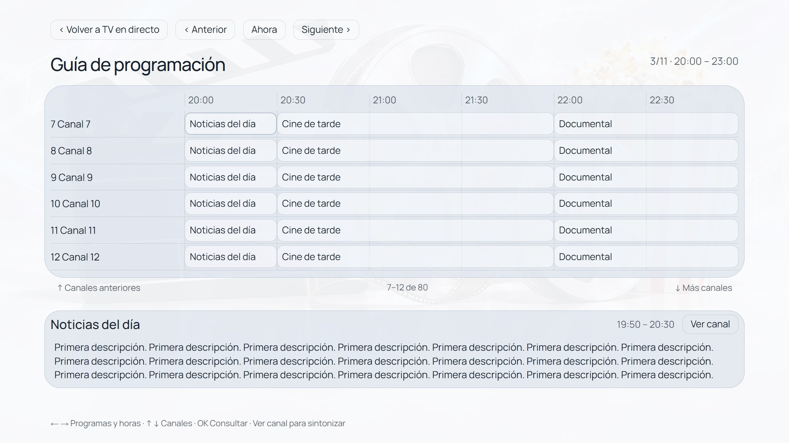
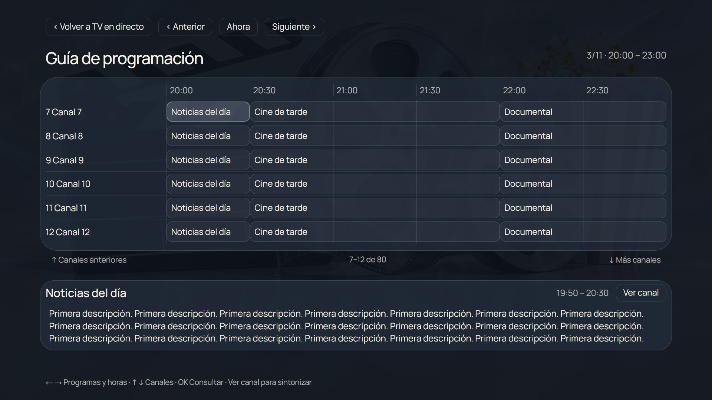
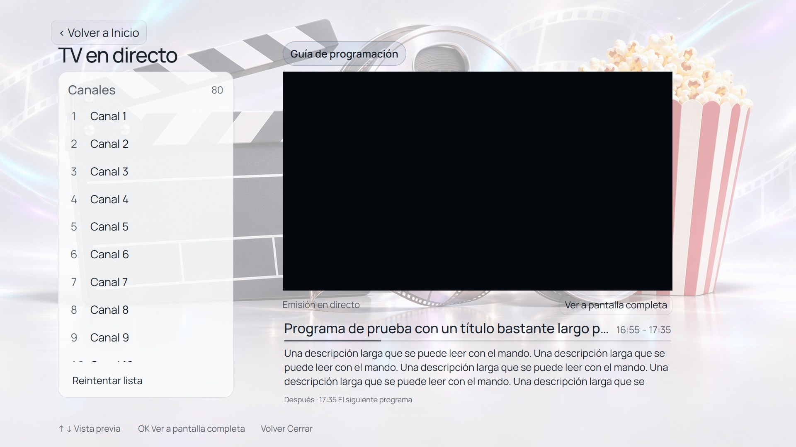

# Screenshots / Capturas

Captured from the current browser preview at 1920×1080 using bundled public fonts and simulated TV APIs. The UI is Spanish; captions below explain each screen in English and Spanish. These are not photographs of the physical TV or evidence of a live broadcast.

Capturas de la vista previa actual a 1920×1080, con fuentes públicas y API de TV simuladas. La interfaz está en español; cada pantalla se explica en ambos idiomas. No son fotografías de la TV ni pruebas de emisión real.

## Night Home / Inicio nocturno

The Dock carousel includes the optional Live TV shortcut. Monochrome icons and focus feedback match the dark wallpaper.

El carrusel Dock incluye el acceso opcional a TV en directo. Iconos monocromos y selección adaptados al fondo oscuro.

## Day Home / Inicio diurno

The light PC background uses dark text and icons. Clock, weekday and separate TV settings remain visible.

El fondo claro de PC usa textos e iconos oscuros. Se mantienen visibles hora, día de la semana y acceso a ajustes TV.

## Launcher settings / Personalización del menú

Use launcher settings to adjust appearance and shortcuts. Samsung quick settings are accessed separately.

Los ajustes del menú permiten cambiar apariencia y accesos. Los ajustes rápidos de Samsung tienen un acceso separado.

## HDMI name editor / Editor de nombres HDMI

A remote-friendly keyboard with explicit Save, Cancel and Original name controls. Names are local aliases; physical ports remain unchanged.

Teclado para mando con Guardar, Cancelar y Nombre original visibles. Los nombres son alias locales y conservan el puerto físico.

## Background gallery / Galería de fondos

Scroll through 22 backgrounds in 11 day/night pairs. Generation prompts and selected masters are included in the design archive.

Galería desplazable de 22 fondos en 11 parejas día/noche. El archivo de diseño incluye descripciones y originales seleccionados.

## Release 1.2 / Versión 1.2

Shared browser previews with sample data. / Vistas previas compartidas con datos de ejemplo.

